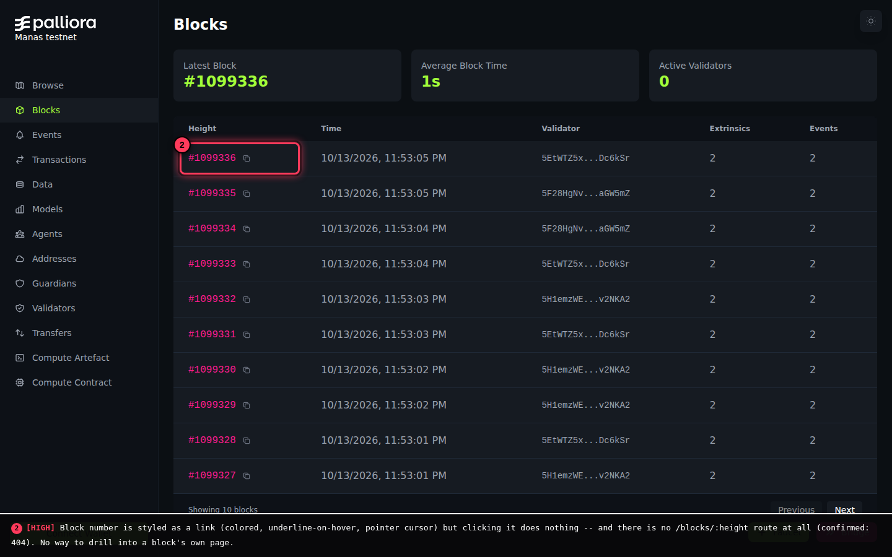
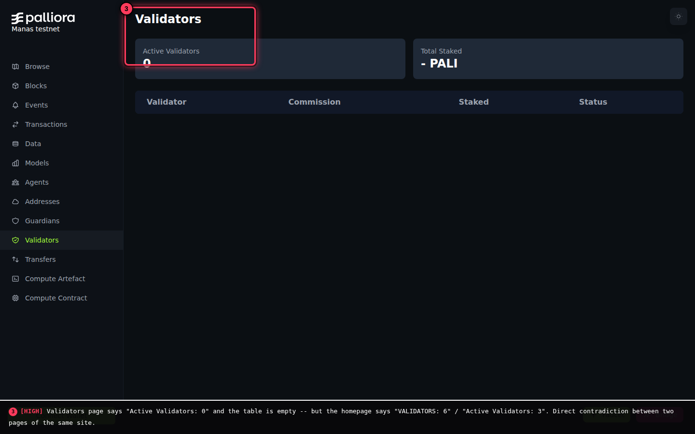
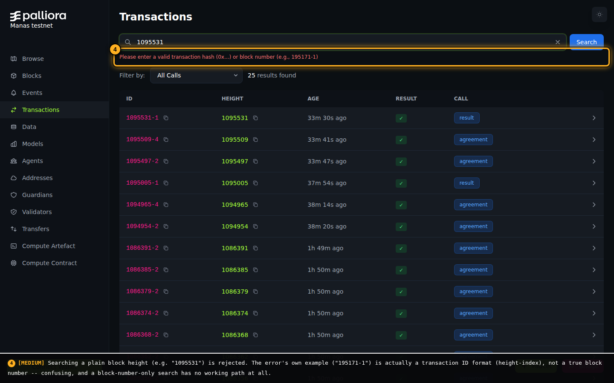
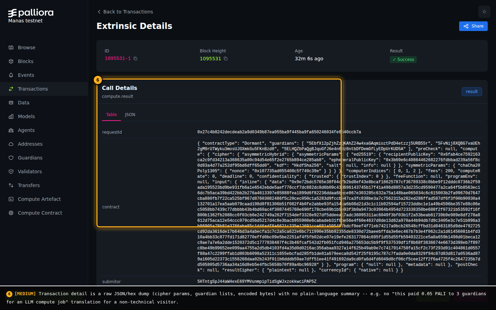
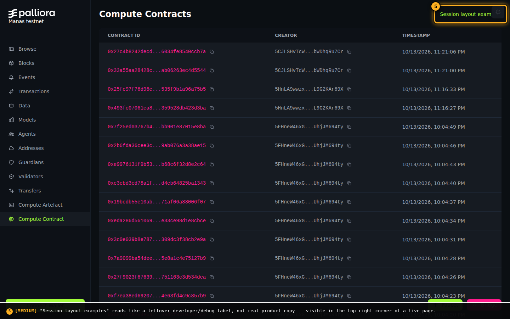
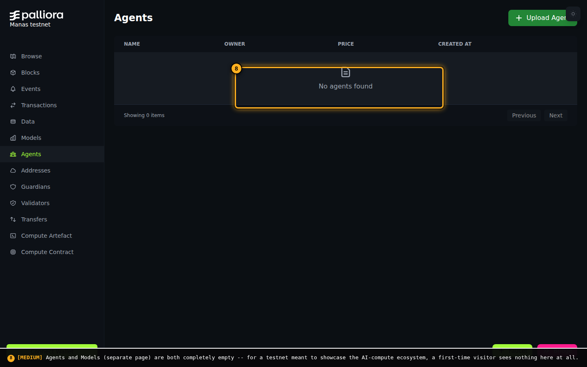
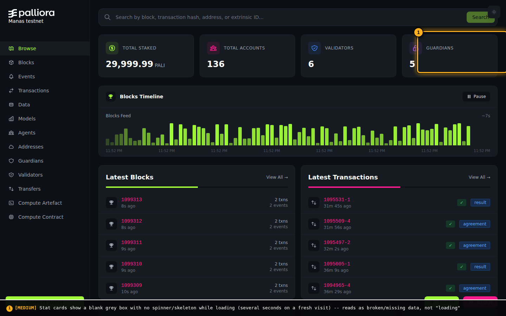
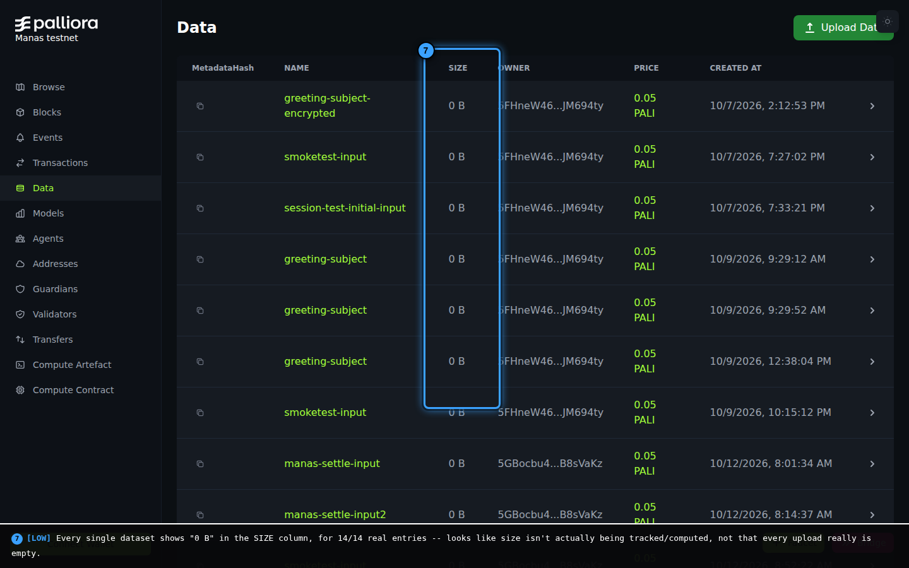

# Explorer usability assessment

**App**: Palliora Explorer (Manas testnet)
**URL**: https://manas.palliora.org
**Date**: 2026-10-13
**Method**: Live, real-browser review (Puppeteer/Chrome) against the production Manas instance -- every finding below is from an actual page load, click, or search, not inferred from code. Annotated screenshots have a colored box + numbered badge drawn directly onto the real rendered page before capture (not freehand markup after the fact), so each box is pixel-accurate to the real element it's calling out.

Screenshots referenced below live in [`screenshots/`](screenshots/). `00-home-baseline.png` is a clean, unannotated reference; `A1`-`A8` are the annotated findings.

## Summary

| Priority | Count |
|---|---|
| High | 2 |
| Medium | 5 |
| Low | 3 |

The explorer's visual design is genuinely strong (see **Wow Factor** below), and the data underneath is real and live. The problems are concentrated in two places: (1) navigation dead-ends and data that contradicts itself between pages, both of which actively damage trust the moment a visitor notices them, and (2) a complete absence of plain-language interpretation anywhere -- every page assumes the visitor already knows what a `daccGuardianGroupInfo` extrinsic or an `asymmetricHybrid` cipher is.

## Findings

### 1. [HIGH] Block numbers look clickable but go nowhere

On `/blocks`, every block height is rendered in the brand accent color with `cursor: pointer` and `hover:underline` -- every visual signal a user has ever learned for "this is a link." Clicking it does nothing. Confirmed the underlying reason: there is no `/blocks/:height` detail route at all (`https://manas.palliora.org/blocks/1098293` returns a 404 page). The only way to see anything about a specific block is indirectly, by finding one of its transactions and opening *that*.

**Why it matters**: this is the single most natural first click for anyone exploring a block explorer. A dead click here costs more trust than almost anything else on the site, because it's the first thing a curious visitor tries.

**Recommendation**: either build a real block-detail page (height, timestamp, validator, full extrinsic list, state root) or, at minimum, remove the link-styling so the number doesn't visually promise something that isn't there.

### 2. [HIGH] The Validators page contradicts the homepage

The homepage's stat cards report **"VALIDATORS: 6"** and, further down, **"Active Validators: 3"**. The dedicated `/validators` page reports **"Active Validators: 0"**, **"Total Staked: - PALI"**, and shows a completely empty table. The `/blocks` page's own stat row *also* independently reports "Active Validators: 0" -- so this isn't a one-off glitch, it's consistent on the page that's supposed to be the source of truth.

**Why it matters**: a block explorer's entire value proposition is "trust what this page tells you about the chain." Two pages of the same site disagreeing about a basic security-relevant number (how many validators are actually active) undermines that for every other number on the site too, not just this one.

**Recommendation**: find and fix the query backing `/validators` (it's returning nothing while the homepage's aggregate stat clearly has real data to pull from) before anything else on this list -- this is the highest-leverage fix here.

### 3. [MEDIUM] Search rejects a plain block number

Typing a bare block height (e.g. `1095531`) into search returns: *"Please enter a valid transaction hash (0x...) or block number (e.g., 195171-1)"*. But `195171-1` -- the error's own example -- is a **transaction ID** format (height-index), not a block number. There is no input format that actually searches by block height alone; you can only reach a block by scrolling/paginating `/blocks` to find it.

**Recommendation**: either accept a bare integer as a block-height search, or fix the error copy so it doesn't call a transaction-ID format a "block number."

### 4. [MEDIUM] Transaction/extrinsic detail is a raw data dump, no plain-language summary

Opening any transaction (e.g. `/transactions/1095531-1`) shows a `Table`/`JSON` toggle (good instinct) but both views are the same raw payload: full cipher parameters, guardian list, hex-encoded ciphertext, nested `asymmetricHybrid`/`chaCha20Poly1305` objects. There is no sentence anywhere that says what actually happened -- e.g. *"3 guardians computed an LLM response for this request, settled for 0.05 PALI."*

**Why it matters**: this is the page where a real compute job -- the actual product -- is visible on-chain. Right now it's indistinguishable from any other blockchain's raw extrinsic dump, which hides exactly the thing that makes Palliora different. See **Wow Factor** below -- this is the highest-leverage opportunity on the whole site, not just a usability nit.

**Recommendation**: add a one- or two-line plain-language summary above the Table/JSON toggle, keyed off the call type (`result`, `agreement`, `daccGuardianGroupInfo`, etc.).

### 5. [MEDIUM] Leftover developer label visible in production

The `/compute-contract` page header shows **"Session layout examples"** in the top-right corner -- reads exactly like a placeholder a developer left in during testing, not real product copy. Visible on every visit to that page.

**Recommendation**: remove it, or replace with something intentional (a real subtitle, or nothing).

### 6. [MEDIUM] Agents and Models pages are completely empty

`/agents` shows "No agents found" / "Showing 0 items." `/models` is identically empty. Both have an "Upload" call-to-action, so the feature clearly exists -- there's simply no seed/sample content.

**Why it matters**: for a testnet whose whole pitch is AI compute (agents, models, guardians, compute contracts), these are arguably the two most exciting pages on the entire site conceptually, and both currently show nothing. See **Wow Factor**.

**Recommendation**: publish 2-3 real or representative sample agents/models so a first-time visitor sees the ecosystem working, not an empty table.

### 7. [MEDIUM] Stat cards flash empty with no loading indicator

On a fresh homepage load, the four top stat cards (Total Staked, Total Accounts, Validators, Guardians) populate asynchronously and out of order -- for several seconds, unresolved cards show a plain empty grey box with no spinner or skeleton animation. They do resolve correctly (confirmed by waiting 8s+), so this isn't broken data, but it's visually indistinguishable from broken data in the moment a visitor actually looks at the page.

**Recommendation**: add a skeleton/pulse loading state to these cards so "loading" reads as loading, not as missing.

### 8. [LOW] Every dataset shows "0 B" size

All 14 real entries on `/data` show `0 B` in the SIZE column. Given these are real uploaded inputs (greeting prompts, smoketest payloads, etc.), it's far more likely size isn't being computed/stored than that every single upload really is zero bytes.

**Recommendation**: check whether size is actually captured at upload time; if it is, the display/field mapping is the bug.

### 9. [LOW] Inconsistent terminology in the transaction CALL column

Not individually screenshotted -- visible throughout `/transactions` (see screenshot 2 and 3 above). The CALL column mixes plain English (`result`, `agreement`, `invoke`) with raw technical pallet-call names (`daccGuardianGroupInfo`, `daccRunAgent`, `daccComputeResult`). A non-technical visitor has no way to know these are the same kind of thing at different levels of detail.

**Recommendation**: either translate the technical names to the same plain style, or add a tooltip/legend explaining the mapping.

### 10. [LOW] Addresses have no human-readable labels

Visible throughout `/addresses`, `/guardians`, `/validators`, and everywhere an address appears. Every address is a raw, truncated SS58 string -- no nicknames for known entities (e.g. "Funding account", "Guardian #1"), so cross-referencing who's who requires manually tracking addresses yourself.

**Recommendation**: a simple known-address label map (even just for guardians/validators/the funder account) would go a long way.

## Wow Factor

*What would make someone unfamiliar with Palliora actually get excited, browsing in from the outside -- separate from the bug list above.*

**What's already working in Palliora's favor:**
- The visual design is genuinely good: a confident dark theme, a distinct two-color brand accent (neon green / hot pink), and a live, animated "Blocks Feed" bar chart on the homepage that communicates "this is a real, continuously running chain" at a glance -- more persuasive than any static stat could be.
- The navigation itself is the pitch: **Models, Agents, Guardians, Compute Artefact, Compute Contract** are first-class nav items, not buried features. That's not a generic Substrate explorer's menu -- it visibly signals "this chain does AI compute," which is the actual differentiator, before a visitor reads a word of copy.
- Faucet and Bridge buttons are persistently visible, which matters a lot for a testnet audience specifically -- it removes the "how do I even try this" friction immediately.

**The single biggest missed opportunity**: the thing that would make Palliora's explorer genuinely stand out isn't more data, it's *translation*. Every other blockchain explorer shows you a hash and a hex blob. Palliora could be the one that shows you **a sentence**: *"Guardian group `5HTn...AP5Z` computed an AI response for `5GbxQ...GRxyck`, using 3-of-3 threshold encryption, settled for 0.05 PALI, 2 seconds ago."* That sentence doesn't exist anywhere on the site today (see Finding 4) -- every transaction, successful or not, currently looks exactly like unreadable cryptographic noise to anyone who isn't already a blockchain engineer. For a product whose whole premise is "AI compute you can verify," being unable to read what actually got computed, in plain language, undercuts the pitch more than any individual bug does.

**Close behind**: a populated Agents/Models page (Finding 6) turns "there's an empty table here" into "here's a real AI agent you can see running on-chain, that other people are actually paying to use" -- which is a materially different, much stronger story for the same page.

**Lower-effort, still high-leverage**: fixing the two High-priority findings (the dead block link, the validator-count contradiction) before a serious outside visitor runs into them matters disproportionately, because trust, once a visitor notices a broken link or a number that doesn't match the page next to it, is hard to win back within the same visit -- no amount of good design further down the page recovers it.
