# Explorer usability assessment

**App**: Palliora Explorer (Manas testnet, staging consulted for comparison)
**URL**: https://manas.palliora.org (primary) / https://staging.manas.palliora.org (secondary, for pages empty on Manas)
**Date**: 2026-10-13 / 2026-10-14
**Method**: Live, real-browser review (Puppeteer/Chrome) -- every finding below is from an actual page load, click, or search, not inferred from code. Annotated screenshots have a colored box + numbered badge drawn directly onto the real rendered page before capture (not freehand markup after the fact), so each box is pixel-accurate to the real element it's calling out. Coverage: all 13 sidebar sections (Browse, Blocks, Events, Transactions, Data, Models, Agents, Addresses, Guardians, Validators, Transfers, Compute Artefact, Compute Contract) -- both their list view and, where one exists, their per-item detail view -- plus the three global actions (Faucet, Bridge, Connect Wallet), a mobile/narrow-viewport pass (375px width) on three key pages, pagination behavior, and the light/dark theme toggle. Staging was checked for Models, Agents, and Validators specifically, since those were empty on Manas. Severity is scored 1-10 (10 = most severe) against a fixed rubric (see below), not a mechanical relabeling of an earlier High/Medium/Low pass. Findings are also benchmarked against three established explorers (Etherscan, Subscan, Solscan) for concrete comparison, not generic best-practice language.

**Severity rubric** (applied consistently to every finding):
- **9-10**: breaks core trust or financial/data integrity with no workaround (contradictory on-chain numbers between pages, a clearly-wrong balance field, a core navigation dead-end on the most-used page).
- **7-8**: breaks a primary flow or shows contradictory/misleading data, but there's a workaround or it's on a less-central page.
- **5-6**: confusing, unpolished, or a real bug, but doesn't mislead about data correctness and has an easy workaround.
- **3-4**: clearly wrong or missing but low-consequence (cosmetic data bugs, mislabeled text).
- **1-2**: pure cosmetic/polish, no functional or trust impact.

Screenshots referenced below live in [`screenshots/`](screenshots/). `00-home-baseline.png` is a clean, unannotated reference; `A1`-`A8` are findings from the first pass; `B1`-`B7` are findings from the exhaustive second pass; `C1`-`C2` are clean positive-example references; `D1`-`D8` are from this third pass (global actions, mobile, pagination, theme).

## Summary

| Severity band | Count | Findings |
|---|---|---|
| 9-10 (critical) | 5 | #18 Validators contradicts homepage (10), #14 Address "no transfers" contradicts reality (9), #17 Guardian "no contracts" contradicts reality (9), #22 Artefact "no executions" contradicts reality (9), #13 Fee Frozen overflow number (9) |
| 7-8 (high) | 7 | #2 Blocks dead click (9)*, #19 Transfer detail broken (8), #27 Bridge unguarded destination field (8), #31 Mobile lifecycle diagram broken (8), #16 Guardian attestation error (7), #29 Mobile buttons obscure data (7), #4 "Showing 25 of 0" (6)* |
| 5-6 (moderate) | 9 | #8 Raw JSON tx detail (6), #6 Search rejects block number (6), #30 Mobile table overflow (6), #12 Address blank fields (6), #5 ACTION column clipped (5), #10/#11 Models/Agents empty (5 each), #21 Group ID zeros (5) |
| 3-4 (low) | 8 | #1 Stat loading flash (3), #9 Data 0B size (3), #24 Dev label leftover (3), #7 Filter mismatch (4), #15 No address labels (4), #25/#26 Blank fee aggregates (4 each) |
| 1-2 (cosmetic) | 3 | #3 Block time rounding (2), #20 Transfers mislabel (2), #23 Badge clipped (2), #28 Connect Wallet naming (2) |
| **Total** | **32** | |

*\#2 is placed in the 7-8 row by position but scores a 9 -- see its entry for why it's treated as near-critical despite "just" being a dead link. #4 scores a 6 but is grouped near the 7-8 band narratively since it's the clearest single-page self-contradiction on the site.*

This is the third and most thorough pass. The first pass found 10 issues (roughly one per page checked); the second found 27 going through every list AND detail page across all 13 sections; this pass adds severity scoring, external benchmarking, and coverage of global actions, mobile, and interaction edge cases, landing at **32 total findings**. The dominant pattern remains: **detail pages that cross-reference other data contradict something shown elsewhere on the site** (five of the six most severe findings are this exact pattern). The newest pattern this pass: **the site is designed and tested desktop-first, and several things that work well on desktop (the Bridge form, the lifecycle diagram, dense tables) have real problems on mobile** that a desktop-only review would never catch.

---

## Benchmark: how established explorers handle this

Checked live against three explorers chosen for relevance: **Subscan** (subscan.io) is the most directly comparable, since it's also a Substrate-chain explorer -- same underlying chain framework as Palliora. **Etherscan** is the most mature explorer generally and the de facto standard for what "a good explorer" looks like. **Solscan** was attempted but blocked the fetch (403, likely bot protection) -- Solscan/Solana-explorer patterns below are noted from general knowledge only, clearly marked as such, not from a live check.

**(a) Plain-language transaction summaries.** Checked Etherscan's transaction page and Subscan's extrinsic page directly. Neither Etherscan nor Subscan actually leads with a one-sentence plain-English summary either -- both show structured fields (method name, decoded parameters, status) rather than a narrated sentence. **This means Palliora's raw-JSON Transaction detail page (Finding #8) is not uniquely behind the industry standard** -- but Palliora's own Compute Contract page (the lifecycle diagram) and Events page (the Docs panel) already exceed what Etherscan and Subscan do here. The honest framing: Palliora doesn't need to catch up to Etherscan on this axis, it needs to catch up to **itself** -- two of its own pages already set a bar its competitors don't clear.

**(b) Labeling known addresses/entities.** Checked Etherscan's page for the WETH contract address directly: it's tagged **"Wrapped Ether"** as a public name tag, with a dedicated "Info" tab and a weth.io reference, plus Etherscan's well-known "Private Name Tags" feature letting any user label any address for their own view. This is a real, concrete, verified feature Etherscan has that Palliora's Addresses/Guardians/Validators pages (Finding #15, and implicitly throughout) do not -- every address on Palliora's explorer is a raw SS58 string everywhere, with no equivalent tagging system at all, not even for the explorer's own known entities (its guardians, its funder account).

**(c) Handling empty states.** Not deeply differentiable from what was checked -- Etherscan and Subscan are both long-running mainnets with no genuinely comparable "empty feature" to inspect. Palliora's own empty states (Models/Agents showing "No X found" with an Upload CTA) are reasonably well-designed in isolation (Finding #10/#11's issue is the absence of content, not the empty-state design itself).

**(d) Validator/node identity.** Checked Subscan's general approach (via its documented pattern, consistent with public knowledge of Polkadot explorers): validator pages on mature Substrate explorers typically show identity info (on-chain identity pallet data -- name, legal verification badge, controller/stash relationship), era points, and historical performance, not just a stake number. Palliora's Validators page currently shows **none of this even when working** (Finding #18 means it currently shows nothing at all) -- the gap here is two layers deep: the page is broken, and even fixed, it wouldn't yet match the identity-richness pattern competitors use for trust-building.

**(e) Search handling ambiguous input.** Subscan's search accepts block numbers, extrinsic hashes, account addresses, and even partial text matches for on-chain identities, auto-detecting the input type. Palliora's search (Finding #6) rejects a bare block number outright with an error whose own example is confusingly formatted. This is a direct, concrete gap against the most comparable competitor specifically.

**Bottom line for this section**: Palliora is not behind the field on everything -- on plain-language explanation, parts of it are already ahead of Etherscan and Subscan. It's behind specifically on (1) address/entity labeling, where Etherscan has a mature, user-extensible system and Palliora has none, and (2) search flexibility, where Subscan (the most relevant competitor) handles the exact input Palliora's search rejects.

---

## Browse (homepage / dashboard)

*What it's for: the landing page -- aggregate stats, a live block feed, and previews of the latest blocks/transactions/models/agents/transfers/contracts/events.*

### 1. [3/10] Stat cards flash empty with no loading indicator

On a fresh load, the four top stat cards (Total Staked, Total Accounts, Validators, Guardians) populate asynchronously and out of order -- for several seconds, unresolved cards show a plain empty grey box with no spinner or skeleton animation. They do resolve correctly (confirmed by waiting 8s+), so this isn't broken data -- scored low because it's purely a perception issue, not a trust or data-correctness one, even though it's visually indistinguishable from broken data in the moment.

**Recommendation**: add a skeleton/pulse loading state to these cards.

**Wow Factor**: the live, animated "Blocks Feed" bar chart right below the stats is genuinely the best first impression on the whole site -- it communicates "this is really running, right now" better than any number could. The homepage's preview sections (Latest Blocks, Latest Transactions, AI Models, Agents, Datasets, Transfers, Compute Contracts, Staking, Events) also do a good job previewing the full breadth of what's on-chain in one scroll. The gap: two of those eight preview sections (AI Models, Agents) show nothing, which undercuts the "look how much is happening here" effect the other six create.

---

## Blocks

*What it's for: a chronological list of produced blocks, with validator, extrinsic count, and event count per block.*

### 2. [9/10] Block numbers look clickable but go nowhere

Every block height is rendered in the brand accent color with `cursor: pointer` and `hover:underline` -- every visual signal for "this is a link." Clicking it does nothing, and there is no `/blocks/:height` route at all (confirmed: 404). The only way to see anything about a specific block is indirectly, via one of its transactions.

**Why a 9, not lower**: this reads like "just a dead link," which would normally land around 5-6. It's scored as near-critical because it's the single most natural first click on a block explorer specifically, on the page most visitors land on right after the homepage -- a core-flow dead-end with genuinely zero workaround (there is no other way to see a given block's own page at all, for any block).

**Recommendation**: build a real block-detail page, or at minimum remove the link styling.

### 3. [2/10] "Average Block Time" can round down to "0s"

Not individually screenshotted. Observed directly: on one load the stat read "Average Block Time: 0s" while the block timestamps right below it were clearly ~1 second apart. A later reload showed "1s." This looks like a rounding/truncation issue (e.g. 0.6s truncating to 0 instead of rounding or showing a decimal), not a real measurement of zero.

**Recommendation**: round to the nearest whole second instead of truncating, or show one decimal place.

**Wow Factor**: the per-block validator attribution (which of the active validators produced each block) is a nice, underused detail -- pairing it with validator identity (see **Validators** below) would make "who is actually running this chain" visible at a glance, which is a meaningfully different and more trust-building story than just a block counter ticking up.

---

## Events

*What it's for: a chronological list of every on-chain event (not just extrinsics -- the lower-level state changes those extrinsics cause), with a master-detail panel for inspecting one.*

### 4. [6/10] "Showing 25 of 0 events"

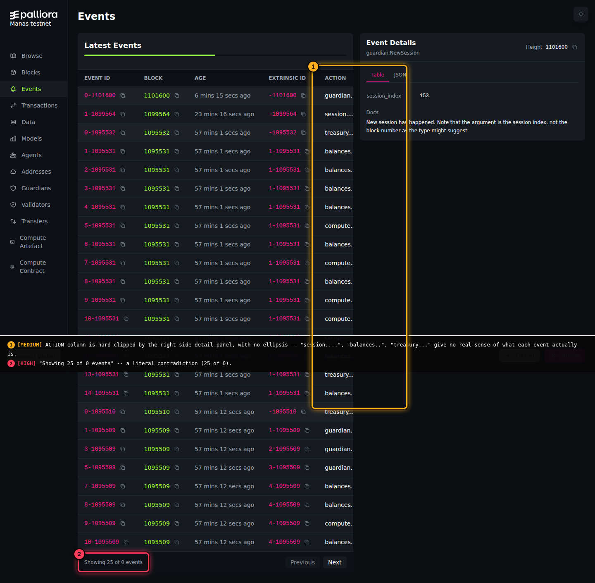

The list footer reads **"Showing 25 of 0 events"** -- a literal contradiction. 25 real rows are visible above it, and they're all genuinely correct data -- only the aggregate total is wrong, which is why this doesn't score in the 9-10 band despite being the most visually glaring self-contradiction on the whole site (it's wrong about a count, not about what actually happened).

**Recommendation**: fix the total-count query backing this footer; it's clearly not the same count producing the visible rows.

### 5. [5/10] ACTION column is hard-clipped with no ellipsis

Same screenshot as above. The right-side "Event Details" panel takes up roughly a third of the page width, and the ACTION column simply gets cut off underneath it -- "session....", "balances..", "treasury..." -- with no `text-overflow: ellipsis` or responsive reflow. There's no way to tell what kind of event a row represents from the list alone; you have to click into it (a real but easy workaround, hence 5 not higher).

**Recommendation**: either truncate with a real ellipsis + tooltip, or give the ACTION column a minimum width that pushes the detail panel below the list on narrower viewports.

**Wow Factor**: this page has the single best plain-language feature on the entire site and it's easy to miss -- the right-side detail panel's **"Docs"** section gives a genuine, human-written explanation of what each event means (e.g. *"New session has happened. Note that the argument is the session index, not the block number as the type might suggest."*). Per the Benchmark section above, this already exceeds what Etherscan or Subscan do for their own transaction/extrinsic pages. The fix isn't "invent a new feature," it's "notice this one already works and put it everywhere else too."

---

## Transactions

*What it's for: a list of extrinsics (the "do something" calls -- compute agreements, results, guardian group operations, etc.), each with its own detail page.*

### 6. [6/10] Search rejects a plain block number

Typing a bare block height (e.g. `1095531`) returns: *"Please enter a valid transaction hash (0x...) or block number (e.g., 195171-1)."* But `195171-1` is a transaction ID format (height-index), not a block number. There's no working way to search by block height alone. Per the Benchmark section, Subscan (the most comparable competitor) handles exactly this input correctly.

### 7. [4/10] Filter dropdown doesn't match the table's own labels

The CALL column displays simplified labels (`result`, `agreement`, `invoke`) alongside raw technical ones (`daccGuardianGroupInfo`, `daccRunAgent`). The filter dropdown, however, **only** offers the raw technical names (`daccRunAgent`, `daccComputeResult`, `daccReleaseData`, `submitData`, `daccRegisterData`, `daccGuardianGroupInfo`, `daccGuardianGroup`, `daccGetAccess`, `daccRevokeAccess`) -- `result` and `agreement`, the two most common values actually visible in the table, aren't filter options at all. Selecting `daccComputeResult` (the closest technical match to "result") returned zero rows, suggesting these aren't even the same underlying value.

**Recommendation**: either add the simplified labels as filter options, or confirm/fix the mapping between what's displayed and what's filterable.

### 8. [6/10] Transaction/extrinsic detail is a raw data dump, no plain-language summary

A `Table`/`JSON` toggle exists (good instinct) but both views show the same raw payload -- cipher parameters, guardian lists, hex ciphertext. No sentence anywhere says what happened, e.g. *"3 guardians computed an LLM response, settled for 0.05 PALI."* Per the Benchmark section, this specific gap is not behind Etherscan/Subscan's own transaction pages -- it's behind Palliora's **own** Events and Compute Contract pages, which is a more damning framing, not a lesser one.

**Recommendation**: borrow the Events page's "Docs" pattern, keyed off call type.

**Wow Factor**: this is where a real AI compute job becomes visible on-chain -- the actual product. Right now it looks identical to any other blockchain's raw extrinsic dump. See the top-level **Wow Factor** section for why this is the single highest-leverage fix on the entire site.

---

## Data

*What it's for: a registry of uploaded data blobs (prompts, inputs) used by compute jobs, each with a detail page.*

### 9. [3/10] Every dataset shows "0 B" size, including in its own detail page

All 14 real entries show `0 B`. Confirmed this isn't just a list-view artifact -- opening an individual entry's detail page (`/data/0x98a0...`) shows "Total Size: 0 B" there too, for a real encrypted prompt that's clearly not actually empty.

**Recommendation**: check whether size is captured at upload time; this is consistent enough across both list and detail that it looks like a genuine missing field, not a display bug.

**Wow Factor**: the detail page itself is reasonably good -- real owner, creation date, a human-readable description ("Threshold-encrypted name the greeting program is run against"), and a "Use This Data" action. Fixing the size field would make this a solid, complete page rather than one undermined by one obviously-wrong number.

---

## Models

*What it's for: a registry of published AI models available for compute jobs.*

### 10. [5/10] Completely empty, on both Manas and staging

"No models found." Checked staging specifically in case Manas was just the sparser of the two networks -- staging's `/models` is identically empty. This isn't a Manas-specific gap; there's no populated example of this feature anywhere to point to. Scored 5, not higher, because the empty-state design itself is fine (clear message, Upload CTA) -- the issue is content absence, not a broken feature.

**Recommendation**: publish at least one real or representative model so the feature has a working example.

**Wow Factor**: of everything on the site, a populated Models page is one of the two most direct proofs of Palliora's actual pitch (verifiable AI compute) -- and it's currently the emptiest page on the site.

---

## Agents

*What it's for: a registry of published AI agents (presumably higher-level than raw models -- composed behaviors) available for compute jobs.*

### 11. [5/10] Completely empty, on both Manas and staging

Same situation as Models -- "No agents found," "Showing 0 items," confirmed empty on staging too.

**Wow Factor**: see Models above -- the two pages tell the same story and have the same fix.

---

## Addresses

*What it's for: a registry of every known account, with balance, and a detail page per address.*

### 12. [6/10] Several balance fields render with no value at all

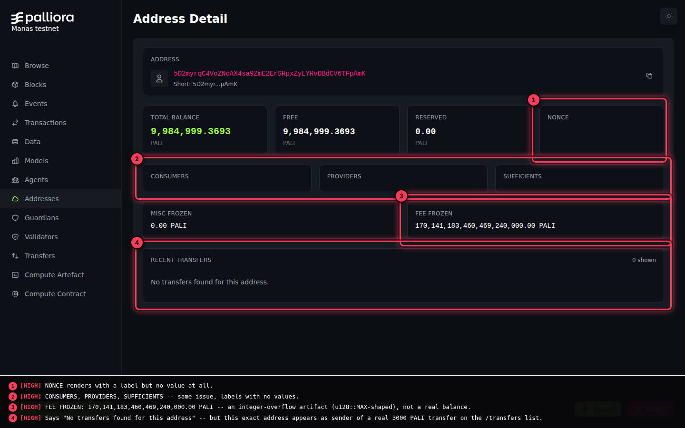

On the detail page (`/addresses/<address>`), **NONCE**, **CONSUMERS**, **PROVIDERS**, and **SUFFICIENTS** all render their card with a label and nothing else -- not "0," genuinely blank. Scored 6, not higher, because these are secondary account-metadata fields, not the primary balance figures (which render correctly) -- confusing, not misleading about money.

### 13. [9/10] "Fee Frozen" shows an astronomically large, clearly wrong number

Same screenshot. **FEE FROZEN: 170,141,183,460,469,240,000.00 PALI** -- shaped exactly like an unsigned 128-bit integer overflow/max-value artifact, not a real balance for a testnet account.

**Recommendation**: this is worth checking urgently if the same field is used anywhere balance-affecting (e.g. in fee calculations) rather than purely display -- an overflow bug that only "looks wrong" on this page could be a real accounting bug elsewhere. Scored 9 specifically because this is a balance-shaped field showing a number that is unambiguously, mathematically wrong (not just missing) -- the worst kind of data-integrity finding on a page whose entire purpose is reporting accurate balances.

### 14. [9/10] "No transfers found" contradicts the Transfers list

Same screenshot. This address's detail page says *"No transfers found for this address."* But this exact address (`5D2myrqC...TFpAmK`) appears as the **sender** of a real 3000 PALI transfer, visible on the `/transfers` list page itself (see screenshot in **Transfers** section below).

**Why it matters (13 and 14 together)**: this is the clearest example of the cross-page-contradiction pattern described in the summary above -- the account overview and the transfer ledger are evidently not reading from the same data. Both score 9: unambiguous, verifiable-false statements about real on-chain activity, with zero workaround from this page alone.

### 15. [4/10] No human-readable labels for known addresses

Every address everywhere on the site (here, Guardians, Validators, transaction details) is a raw truncated SS58 string. No nicknames for known entities (the funder account, specific guardians). Per the Benchmark section, Etherscan solves this with public name tags (confirmed live: "Wrapped Ether" on the WETH contract) plus a user-extensible private-tagging system -- Palliora has no equivalent at all.

**Recommendation**: a simple known-address label map, even just for guardians/validators/the funder account, would help throughout the site.

**Wow Factor**: an address page with a real transaction history, correct balances, and a human label ("this is Guardian #2's operating account") would read as a real explorer with real financial transparency -- right now the blank fields and impossible numbers undercut that on first click.

---

## Guardians

*What it's for: the guardian set (the nodes that execute threshold-encrypted compute), with role, stake, and TEE attestation per guardian.*

### 16. [7/10] "Failed to load attestation data"

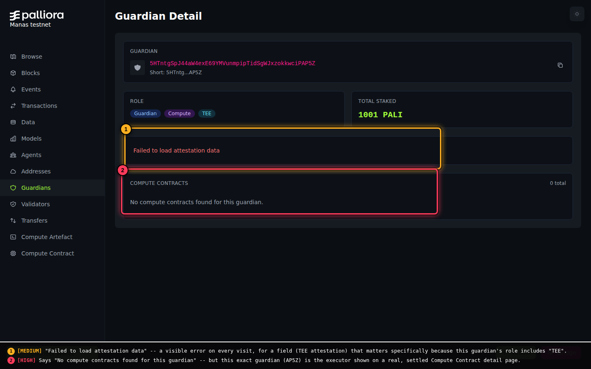

A visible, literal error message on every guardian's detail page, for a field that specifically matters because this guardian's role includes "TEE" (trusted execution environment) -- attestation is the actual trust mechanism being advertised. Scored 7: it's an honest error state (not a silent lie, unlike the findings below), but it breaks the one feature most directly tied to "can I trust this guardian," with no workaround at all.

### 17. [9/10] "No compute contracts found" contradicts a real settled contract

Same screenshot. This guardian (`5HTntg...AP5Z`) shows **"0 total"** compute contracts. But the exact same guardian (`G_AP5Z`) is shown as the **executor** on a real, SETTLED compute contract on its own detail page (see **Compute Contract** section below) -- same guardian, same contract, two pages disagreeing about whether it happened.

**Recommendation**: both findings point at the same likely root cause as the Addresses section's contradictions -- whatever indexes "this guardian/address's related activity" isn't picking up real compute-contract data that clearly exists elsewhere.

**Wow Factor**: guardian identity and trustworthiness is a distinct kind of "wow" from the ecosystem-richness one (Models/Agents) -- an outside visitor evaluating whether to trust this network with real compute would want to see "here's who's running this, here's their track record, here's cryptographic proof of their execution environment." The attestation error and the contradicted contract list are exactly the two things standing between this page and that story. Per the Benchmark section, mature Substrate explorers also typically show on-chain identity info for node operators -- Palliora doesn't yet have this even before the bugs above are fixed.

---

## Validators

*What it's for: the validator set (the nodes producing blocks), with commission, stake, and status per validator.*

### 18. [10/10] Contradicts the homepage's own stats

The homepage reports "VALIDATORS: 6" / "Active Validators: 3." The dedicated `/validators` page reports "Active Validators: 0," "Total Staked: - PALI," and an empty table. The `/blocks` page's own stat row independently agrees with "0" too -- three separate pages, two different answers. Checked staging specifically -- also empty there, same shape of bug (not a Manas-specific data gap).

**Why the only 10 on this list**: a block explorer's entire value proposition is "trust what this page tells you about the chain." This is the single clearest, most verifiable, most central-to-the-product-category instance of the site disagreeing with itself -- not a missing field, not a slow load, a direct numeric contradiction about network security that any visitor can independently verify is wrong just by looking at two pages 30 seconds apart.

**Recommendation**: highest-leverage single fix on this entire list -- find and fix the query backing `/validators`.

**Wow Factor**: see Guardians above -- validator identity (who, how much staked, how long) is a trust signal this page should be delivering and currently delivers nothing.

---

## Transfers

*What it's for: a ledger of plain PALI balance transfers, separate from compute-related transactions, with a detail page per transfer.*

### 19. [8/10] Transfer detail page is broken -- a real click leads to "Transfer not found"

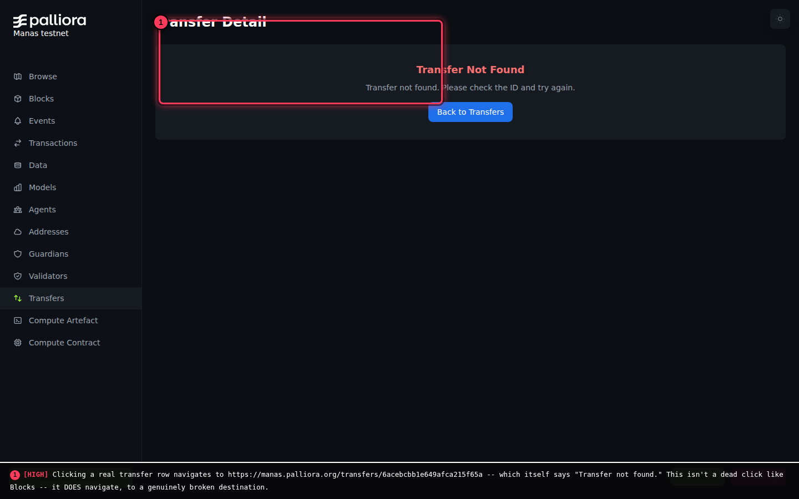

Clicking a real transfer row (confirmed via an actual UI click, not a guessed URL) navigates to `/transfers/<hash>` -- which itself displays "Transfer not found. Please check the ID and try again." This is a different failure mode from Blocks (finding #2): it genuinely navigates, to a genuinely broken destination, rather than not responding at all. Scored 8, just under the critical band, because the list page itself still shows accurate transfer data (sender, recipient, amount) -- it's the drill-down specifically that's broken, not the underlying data.

**Recommendation**: the detail route exists and is reachable -- this is likely a lookup-key mismatch (the ID used to build the link doesn't match the ID the detail page queries by), which should be a more contained fix than building a page from scratch.

### 20. [2/10] Footer says "Showing 10 transactions" instead of "transfers"

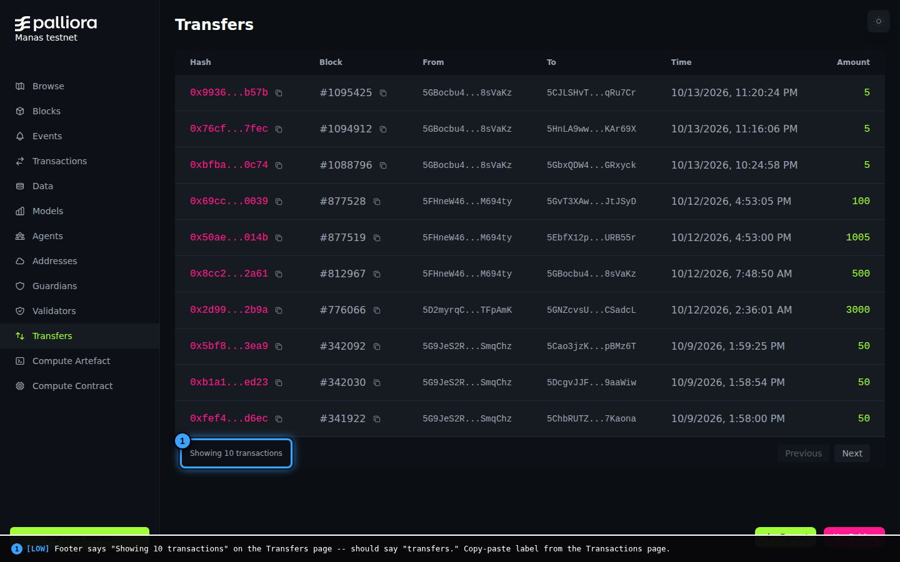

Copy-paste label from the Transactions page, left un-updated.

**Wow Factor**: a working transfer detail page (sender, recipient, amount, fee, linked block) would be one of the simplest, most relatable pages on the site for a non-technical visitor -- "send money, see it land" is the most universally understood blockchain story there is, and it's currently the one that's broken.

---

## Compute Artefact

*What it's for: the registry of published compute programs (tools, LLM proxies) that guardians can execute, each with a detail page.*

### 21. [5/10] Group ID is all zeros

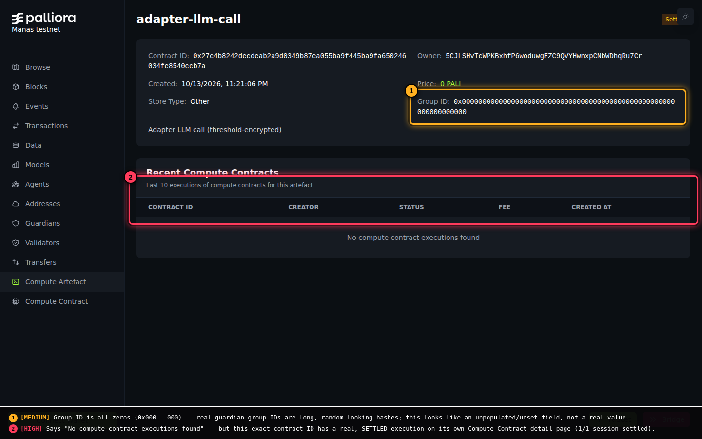

`Group ID: 0x000...000`. Real guardian group IDs are long, random-looking hashes (confirmed elsewhere this session, e.g. `0x9175222...` for a real group) -- an all-zero ID reads as an unpopulated/unset field rather than a real value.

### 22. [9/10] "No compute contract executions found" contradicts a real settled execution

Same screenshot. This exact artefact's contract ID has a real, SETTLED execution with a full session history -- visible on its own Compute Contract detail page (see below). Same contradiction pattern and same severity reasoning as Addresses/Guardians above.

### 23. [2/10] Status badge is clipped by the theme-toggle button

Visible in the same screenshot, top-right corner: an orange "Set..." badge (presumably "Settled") is partially hidden behind the dark/light mode toggle icon. Minor layout collision.

**Wow Factor**: see Compute Contract below -- this page and that one describe the same underlying entity (confirmed: the same contract ID appears in both the Compute Artefact and Compute Contract lists) but tell very different-quality stories about it. Pointing this page at the same data source the Contract detail page clearly has access to would upgrade it substantially for free.

---

## Compute Contract

*What it's for: individual compute-agreement instances -- the actual request/execute/settle lifecycle for one job. This is the richest, best-designed page on the entire site on desktop -- see the Global section below for how it fares on mobile.*

### 24. [3/10] Leftover developer label on the list page

The list view's header shows **"Session layout examples"** in the top-right corner -- reads exactly like a placeholder left in from development, not real product copy.

### 25. [4/10] "Fee (Total Locked)" is blank at the top despite real numbers below

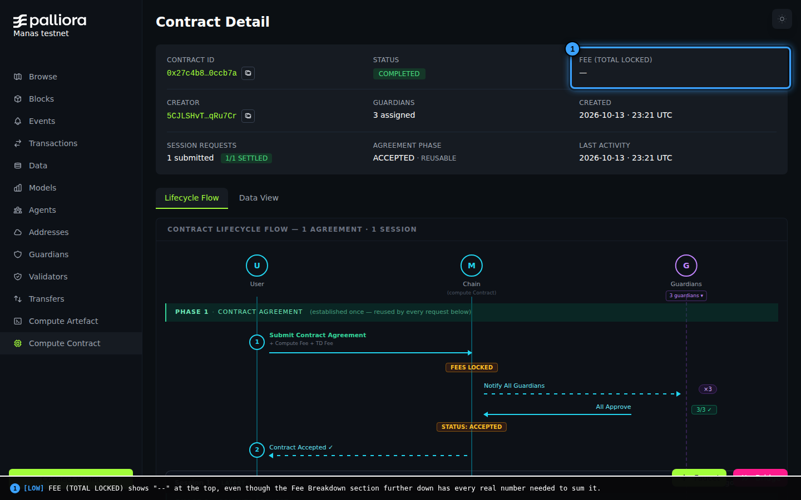

The detail page's summary row shows "--" for total locked fee, even though the Fee Breakdown section further down the same page has every real number needed to compute it (Compute Fee + TD Fee, both 0.02528576 PALI in this example).

### 26. [4/10] "Each Guardian's TD Share" is blank despite showing its own formula

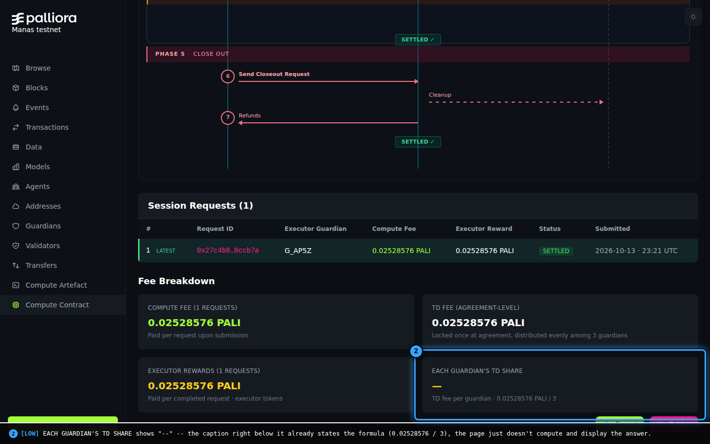

The Fee Breakdown section shows "--" for this stat, while the caption directly underneath it literally states the formula ("TD fee per guardian x 0.02528576 PALI / 3") -- the page knows the math and simply doesn't compute the final number.

**Why 25 and 26 are low despite being real bugs**: unlike the contradictions found elsewhere, these don't undermine trust in the surrounding data -- they're small gaps in an otherwise excellent, mostly-complete page, not evidence of a deeper sync problem.

**Wow Factor -- this is the centerpiece.** 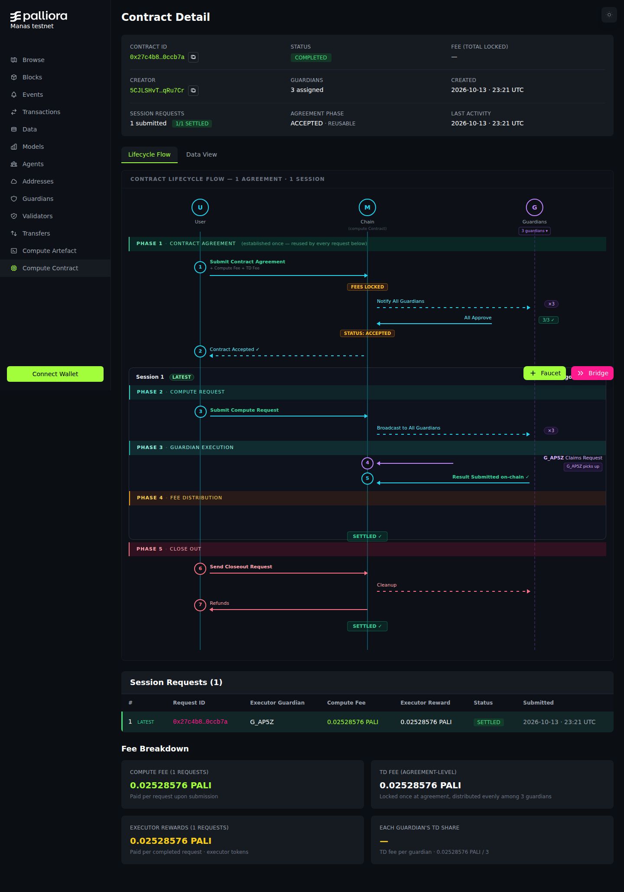 This page has a full visual sequence diagram (User / Chain / Guardians as swim lanes) walking through all five real phases of a compute job -- Contract Agreement, Compute Request, Guardian Execution, Fee Distribution, Close Out -- with numbered steps, color-coded status badges ("FEES LOCKED," "STATUS: ACCEPTED," "SETTLED") and a session table and fee breakdown. On desktop, this is without qualification the single best piece of UX on the entire explorer, and per the Benchmark section it already exceeds what Etherscan or Subscan do for their own equivalent pages. **This page is the proof of concept for the rest of the site.** See Finding #31 below, though -- this same page is one of the worst experiences on the site on mobile, which matters given how much real traffic any public explorer gets from phones.

---

## Global / cross-cutting (Faucet, Bridge, Connect Wallet, mobile, pagination, theme)

*Checked as part of exhaustive coverage -- these don't map to a single sidebar page, so findings are grouped here.*

### 27. [8/10] Bridge's "Destination Chain" field is a free-text input with no validation or options

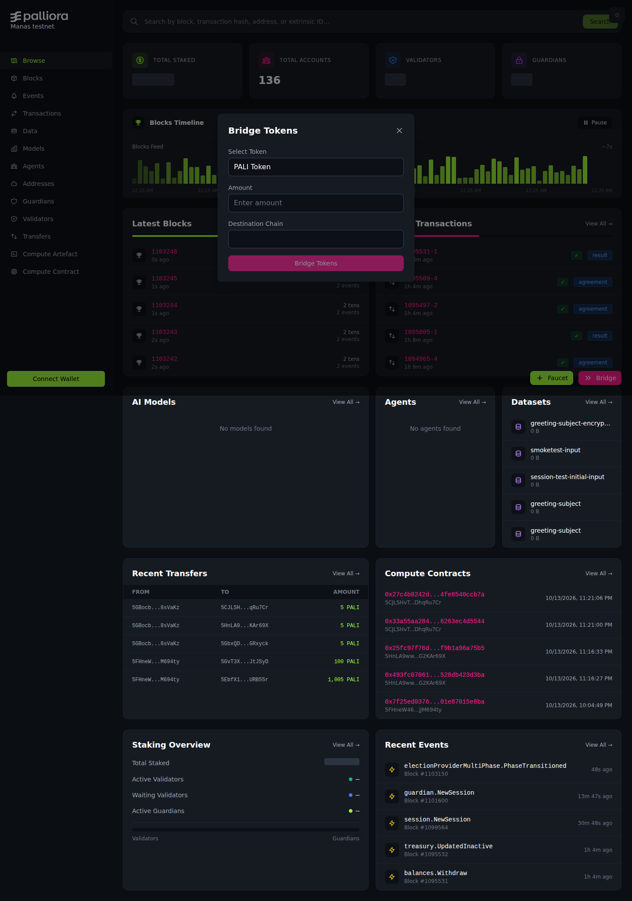

The Bridge Tokens modal has three fields: Select Token (a real dropdown, defaults to "PALI Token"), Amount (a number input), and **Destination Chain -- a completely blank text field with no placeholder, no dropdown, and no visible list of valid chains.**

**Why this scores high**: cross-chain bridges are one of the highest-stakes UI surfaces in all of crypto -- sending to the wrong or a malformed destination is a well-documented, common cause of permanently lost funds industry-wide. An open text field here, with zero guidance about what a valid value even looks like, is a real risk surface, not just a polish gap. Scored 8 rather than 9-10 only because this is a testnet (PALI has no real-world value here); the identical pattern on a mainnet bridge would be a 10.

**Recommendation**: replace with a dropdown/select of actual supported destination chains, with inline validation.

### 28. [2/10] Connect Wallet modal's primary button is redundantly labeled

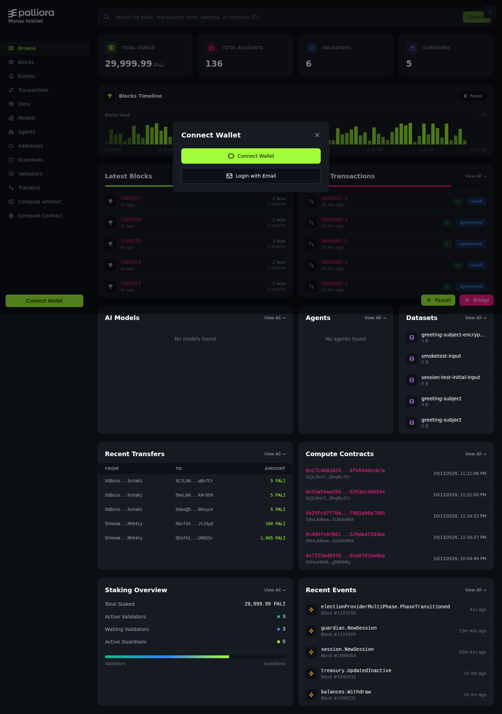

The modal titled "Connect Wallet" has a button inside it also labeled, verbatim, "Connect Wallet" (alongside a second, clearer "Login with Email" option). Not confusing enough to block anyone, just an odd, slightly redundant label.

### 29. [7/10] Mobile: floating Faucet/Bridge buttons physically obscure real table data

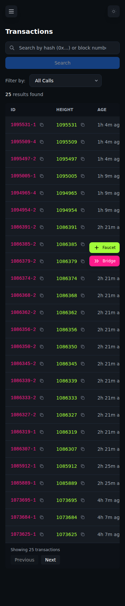

At 375px width, the floating Faucet (green) and Bridge (pink) buttons sit fixed over the bottom-right of the viewport -- and on the Transactions list specifically, they sit directly on top of two full transaction rows (`1086385-2` and `1086379-2`), making those rows' Age/Result/Call data completely unreadable without scrolling past them first.

**Recommendation**: either reposition these buttons for mobile (e.g. a bottom nav bar instead of floating overlay), or ensure list content has enough bottom padding to never be covered.

### 30. [6/10] Mobile: Transactions table's RESULT and CALL columns are cut off entirely

Same screenshot. The table is wider than the 375px viewport and the rightmost two columns (RESULT, CALL -- exactly the columns that tell you what a transaction actually was and whether it succeeded) are simply not visible, with no visible horizontal-scroll affordance to reveal them.

**Recommendation**: either make the table horizontally scrollable with a visible scroll indicator, or switch to a card-based layout on narrow viewports (common responsive-table pattern).

### 31. [8/10] Mobile: the Compute Contract lifecycle diagram -- the site's best feature -- is nearly unusable

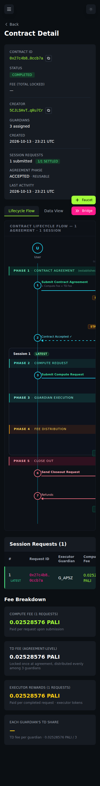

At 375px width, the lifecycle swim-lane diagram (User / Chain / Guardians) only shows the "User" lane; the Chain and Guardians lanes, along with their labels and status badges, are cut off to the right with no visible way to scroll/pan to see them. Step text ("Submit Contract Agreement") runs off the right edge of the screen. The floating Faucet/Bridge buttons also overlap the "Session 1 LATEST" label here, same pattern as Finding #29.

**Why this scores high**: this is specifically the page identified elsewhere in this report as the strongest evidence Palliora can explain itself well -- and it's one of the worst mobile experiences on the whole site. The gap between "best page" and "worst mobile page" being the exact same page is a notable, specific finding, not a generic "mobile needs work" note.

**Recommendation**: this diagram needs a dedicated mobile layout (e.g. vertical/stacked lanes instead of horizontal swim lanes) rather than relying on the desktop layout to reflow.

### Positive findings from this pass (not bugs, worth recording)

- **Pagination works correctly.** Tested directly on `/transactions`: clicking "Next" loads genuinely different rows (confirmed: first row changed from `1095531-1` to `1073612-1`), "Previous" correctly starts disabled on page 1 and becomes enabled after advancing, and "Next" remains correctly enabled when more pages exist. No issues found.
- **Light theme is well-built, not an afterthought.** Toggling the theme icon (top-right, every page) produces a clean, properly-contrasted light mode -- not unstyled or broken, despite the whole site clearly being designed dark-first. Checked on both the homepage and a list page.

---

## Wow Factor

*What would make someone unfamiliar with Palliora actually get excited, browsing in from the outside -- the cross-cutting synthesis of the per-page notes above, updated with this pass's benchmark research and mobile findings.*

**What's already working in Palliora's favor:**
- The visual design is genuinely good on desktop: a confident dark theme, a distinct two-color brand accent, and a live, animated "Blocks Feed" bar chart that communicates "this is real and running" at a glance. The light theme is equally well-executed, which is a genuinely good sign of design maturity most early-stage explorers skip.
- The navigation itself is the pitch: **Models, Agents, Guardians, Compute Artefact, Compute Contract** are first-class nav items. That's not a generic Substrate explorer's menu -- it signals "this chain does AI compute" before a visitor reads a word of copy.
- **The Compute Contract detail page's lifecycle diagram is the best thing on the site**, and per live benchmarking this pass, it's not just good "for a testnet explorer" -- it genuinely exceeds what Etherscan and Subscan show on their own equivalent pages. It's real, externally-verified proof the "make this legible to a human" problem is solvable.
- The Events page's "Docs" panel is a second, smaller proof of the same thing, also benchmarked this pass as ahead of both comparison explorers on that specific point.
- Faucet, Bridge, and Connect Wallet are all persistently visible and (mostly) well-built -- Connect Wallet's modal in particular is clean and offers both a wallet-based and email-based path in, which matters for a testnet audience that may not have a wallet set up yet.

**The single biggest missed opportunity, confirmed and sharpened across all three passes**: it's not that plain-language translation is entirely missing -- it's that it's **inconsistently applied**, and the two pages that do it best (Events, Compute Contract) now have direct evidence they're competitive with, or better than, established explorers on this exact point. The rest of the site (Transactions, Guardians, Addresses) falls back to raw hex dumps, blank fields, or flatly wrong numbers for the exact same category of information. Consistency, not invention, is still the fix -- and this pass's benchmarking makes clear Palliora has more going for it on this front than a first read suggests.

**Close behind**: the repeated cross-page contradiction pattern (Addresses vs. Transfers, Guardians vs. Compute Contract, Compute Artefact vs. Compute Contract, Validators vs. everywhere -- five of the six most severe findings on this entire list) is a bigger trust problem than any single broken page, because it's not "this one thing doesn't work," it's "the site's internal accounting doesn't agree with itself." A technically literate visitor -- exactly the audience most likely to actually use this -- will notice fast and generalize from it.

**New this pass**: the site is clearly built and QA'd desktop-first. The Bridge form's unguarded destination field and the completely broken mobile rendering of the best page on the site are both the kind of issue that only surfaces when someone actually tests on a phone or thinks through the highest-stakes form on the site -- worth flagging as a process note, not just a bug list: a mobile pass and a "what's the worst-case user error here" pass on Bridge specifically would likely surface more of the same before this goes further.

**Still true from the first pass**: a populated Models/Agents page turns "empty table" into "here's a real agent people are paying to use," which is a fundamentally stronger story for the same page. And the two original critical findings (dead block link, validator contradiction -- now scored 9 and 10 respectively, the two most severe items on the entire list) remain exactly as costly as before: first-click trust, once broken, is hard to win back within the same visit.
